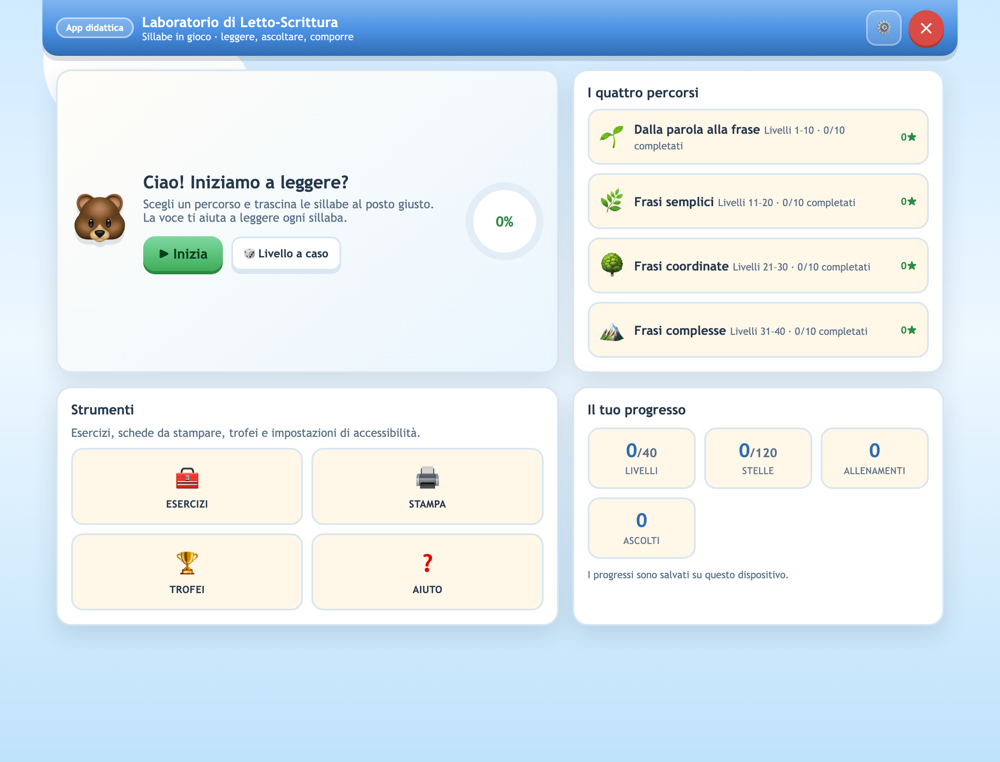
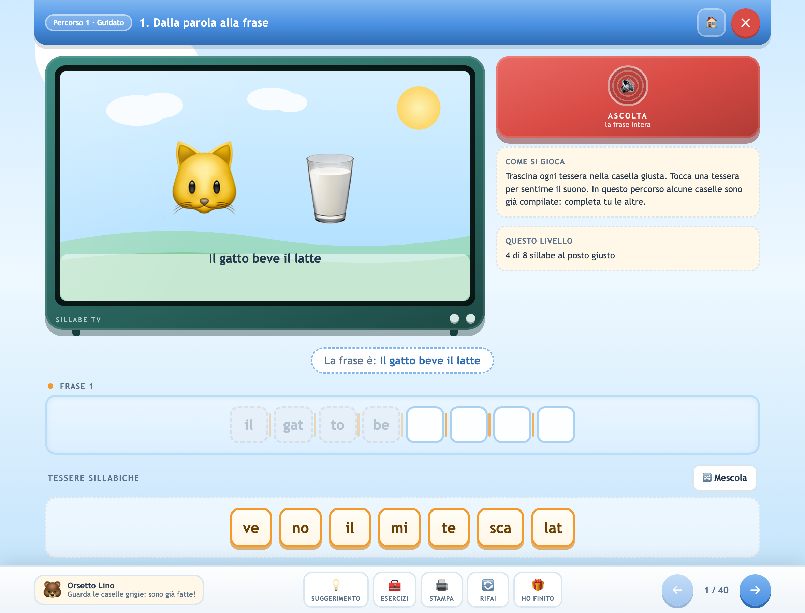

# Sillabe in Gioco · Laboratorio di Letto‑Scrittura

App didattica per l'apprendimento della letto‑scrittura in italiano: si compongono frasi
trascinando tessere sillabiche, con sintesi vocale, illustrazioni generate al volo,
esercizi, schede stampabili e trofei.

**40 livelli · 4 percorsi · 20 parole da comporre · 20 suoni difficili · nessun dato che lascia il dispositivo.**



---

## Indice

- [Funzionalità](#funzionalità)
- [Percorsi didattici](#percorsi-didattici)
- [Accessibilità](#accessibilità)
- [Avvio rapido](#avvio-rapido)
- [Installazione](#installazione)
- [Comandi di sviluppo](#comandi-di-sviluppo)
- [Struttura del progetto](#struttura-del-progetto)
- [Architettura](#architettura)
- [Privacy](#privacy)
- [Pubblicazione](#pubblicazione)
- [Licenza](#licenza)

---

## Funzionalità

### Gioco
- **Trascinamento delle sillabe** con snap‑in magnetico nella casella corretta.
- Tre modalità d'ingresso alla tessera: **drag & drop** (mouse, dito, penna), **tap su tessera + tap sulla casella**, **tastiera** (Invio/Spazio).
- **Un'illustrazione originale per ognuna delle 40 frasi e per ognuna delle 20 parole**: scene vettoriali da libro illustrato (personaggi, animali, arredi, paesaggi) in 1280×720, senza alcun testo dentro il disegno.
- Tessere **distrattore** sempre presenti, rimescolabili con un tocco.
- Animazioni di conferma, errore (shake), completamento (pop + coriandoli).

### Formazione di parole
Una sezione propedeutica in due tappe, con **20 parole illustrate**:

| Tappa | Parole | Pezzi |
|---|---|---|
| 1 · Unisco le lettere | ape, mela, sole, luna, pane, casa, dado, faro | una lettera alla volta |
| 2 · Unisco le sillabe | gatto, cane, pesce, rana, topo, fiore, palla, treno, nave, libro, ombrello, campana | una sillaba alla volta |

- La parola **cresce sotto le caselle** mentre il bambino la compone.
- Ogni parola ha la sua **figura** (nessun testo nel disegno) e la sua voce.
- 3 distrattori per parola, sempre diversi dai pezzi corretti.
- Tappa successiva/precedente, mescola, suggerimento, rifai.

### Suoni difficili
**20 esercizi finali** sui gruppi ortografici che creano più errori:
`che · chi · ce · ci · cia · cio · ciu · ge · gi · ghe · ghi · gli · gn · gno · sci · sce · spr · str · squ · qua`.

Si ascolta la parola intera (*formiche, chitarra, cesto, città…*) e si sceglie la grafia giusta
fra quattro; la scheda del suono mostra il gruppo e la parola con il gruppo evidenziato.

### Voce
- **Voci preregistrate con voce neurale italiana**, incluse nel pacchetto: 182 sillabe e lettere,
  40 frasi, 163 parole e le battute dell'interfaccia (393 clip, ≈1 MB). Identiche su ogni
  dispositivo, anche senza voci italiane installate nel sistema.
- **Le sillabe non vengono più compitate.** Con la sintesi di sistema alcune sillabe
  isolate (`ac`, `ap`, `ia`, `ta`, `uc`) venivano lette come sigle, lettera per lettera;
  i clip preregistrati eliminano il problema alla radice. Un test di regressione
  (`npm run test:pronuncia`) confronta ogni sillaba critica con la sua lettura
  compitata e fallisce se le due coincidono.
- **Le lettere suonano come fonema, non come nome.** La tessera `s` fa sentire un /s/
  tenuto, non «esse»; `m` un /m/ tenuto, non «emme». Attenzione: scrivere la lettera
  ripetuta (`sss`) **non** funziona — la voce la legge come una sigla e compita il nome
  tre volte («esse esse esse»). I clip si ricavano quindi **ritagliando** il fonema
  dall'audio della voce — la geminata che ogni nome di lettera contiene (*e**ss**e*,
  *e**mm**e*) o una parola vera per `v` (*a**vv**io*) — e **rallentandolo** con `atempo`
  fino a 0,40 s: un solo suono continuo, pronunciato adagio, senza loop e senza
  ripetizioni. Quelli che non si possono tenere (`t`, `p`, `b`, `d`, `c`, `g`) sono
  chiusura + scoppio, una volta sola, senza la /i/ di «ti», «pi», «bi».
  Il test `npm run test:pronuncia` analizza la forma d'onda e fallisce se un clip
  contiene più di un blocco di suono o se l'inviluppo si ripete (cioè se è un loop).
- **Sintesi di sistema come riserva** (Web Speech API, `it-IT`): se un file audio manca,
  l'app torna a leggere con la voce del dispositivo e preferisce le voci neurali/premium.
- Lettura **scandita sillaba per sillaba** con la pausa giusta tra una sillaba e l'altra.
- **Un solo suono per gesto**: un tocco legge la sillaba una volta sola (il *pointerdown* non
  parla, parlano il *click* per il tap e l'inizio del trascinamento).
- Voce, velocità e lettura automatica configurabili. La lettura delle parole intere si può
  spegnere: in quel caso la radio resta muta e i pulsanti lo dicono.
- Tasto **ASCOLTA** (radio vintage) per riascoltare la frase in qualsiasi momento.

### Supporto didattico
- **SUGGERIMENTO**: fa lampeggiare insieme la tessera corretta e la casella di destinazione.
- **RIFAI**: azzera il livello mantenendo la stessa frase.
- **HO FINITO**: verifica l'avanzamento e segnala quante sillabe mancano.
- **Mescola**: cambia l'ordine delle tessere.
- **Mascotte** Orsetto Lino con consigli contestuali e lettura della sillaba successiva.

### Esercizi
8 domande generate casualmente su quattro tipi:

1. **Ascolto** — riconoscere la sillaba pronunciata.
2. **Iniziale** — individuare la prima sillaba di una parola.
3. **Conteggio** — contare le sillabe.
4. **Lacuna** — completare la parola mancante.

Punteggio, precisione, record personale e numero di sessioni salvati.

### Stampa
Scheda di lavoro A4 pronta per la classe: frase, caselle da riempire, tessere da ritagliare e spazio per nome/data/stelle.

### Progressi e trofei
- Stelle per livello (3 = nessun errore, 2 = fino a 2 errori, 1 = oltre).
- 8 trofei: primo passo, esploratore, metà strada, campione, perfezionista, voce d'oro, allenamento, da solo.
- Salvataggio locale automatico e possibilità di azzerare i dati.

### Personalizzazione
- Dimensione del testo (90%–150%).
- Velocità della voce e scelta della voce italiana di sistema.
- **Tutto maiuscolo on/off**: tessere, caselle e parole in MAIUSCOLO per chi sta imparando
  a riconoscere le lettere; le etichette dell'interfaccia restano in minuscolo leggibile.
- **Lettura delle parole on/off**: spegne la voce sulle parole intere (restano le sillabe).
- **Esercizio scelto dal docente**: dal menu impostazioni si sceglie il quiz misto, tutti e
  20 i suoni difficili oppure un singolo suono, e si avvia subito con ▶.
- **Tema scuro** per ridurre l'affaticamento visivo.
- Effetti sonori on/off, lettura automatica on/off, riga suggerimento on/off.
- Riduzione delle animazioni.



---

## Percorsi didattici

| Percorso | Livelli | Contenuto | Modalità |
|---|---|---|---|
| 1 · Guidato | 1–10 | Soggetto + verbo + oggetto | Riga suggerimento, 4–5 caselle precompilate |
| 2 · Frasi semplici | 11–20 | Frasi lineari complete | Tutte le caselle da riempire |
| 3 · Coordinate | 21–30 | Due frasi unite da *e, ma, poi* | Due righe + connettore centrale |
| 4 · Complesse | 31–40 | Causali, temporali, relative | Due parti: subordinata + principale |

Esempi:
- `1. Il gatto beve il latte` → `il · gat · to · be · ve · il · lat · te`
- `21. Il gatto dorme e il cane abbaia` → due righe unite dal connettore **e**
- `31. Quando piove il bambino apre l'ombrello` → parte 1 + parte 2

Tutte le 40 frasi sono diverse tra loro; il controllo è automatizzato (`npm run validate`).

---

## Accessibilità

- Tutti i controlli sono `<button>` nativi: focus visibile, attivabili con Invio/Spazio.
- Etichette `aria-label` su caselle, tessere, illustrazioni e pulsanti.
- Regioni `aria-live` per annunciare suggerimenti, errori e completamenti.
- Contrasto verificato su testo e controlli; target touch ≥ 44 px.
- `prefers-reduced-motion` rispettato, più opzione manuale di riduzione animazioni.
- Nessun limite di tempo, nessun suono obbligatorio, nessuna penalità bloccante.
- Testo ridimensionabile fino al 150% senza rotture di layout.

---

## Avvio rapido

Serve **Node.js 18+** solo per lo sviluppo e il packaging. L'app in sé non ha dipendenze runtime.

```bash
git clone https://github.com/MaestroLivio/sillabe-in-gioco.git
cd sillabe-in-gioco
npm install          # solo per gli strumenti di build
npm run serve        # http://localhost:4321
```

In alternativa, apri direttamente `index.html` nel browser: tutto funziona tranne il
service worker (che richiede `http://` o `https://`).

---

## Installazione

### macOS

```bash
npm run build:mac
```

Genera in `dist/`:

- `Sillabe in Gioco-2.2.5-arm64.dmg` (Apple Silicon)
- `Sillabe in Gioco-2.2.5.dmg` (Intel)
- versioni `.zip` per gli aggiornamenti automatici

Installazione: apri il `.dmg` e trascina l'app in **Applicazioni**.

> [!NOTE]
> Le build sono firmate **ad-hoc** (`scripts/sign-mac.js`), non con un
> certificato Apple Developer: la firma è valida sul disco e sigilla il
> pacchetto — è quello che serve a macOS su Apple Silicon per avviare l'app —
> ma Gatekeeper non riconosce lo sviluppatore. Al primo avvio di un pacchetto
> scaricato usa tasto destro → **Apri**, oppure *Impostazioni di Sistema →
> Privacy e sicurezza → Apri comunque*.
> Per la firma con un certificato vero: imposta `CSC_LINK` e
> `CSC_KEY_PASSWORD`, togli `CSC_IDENTITY_AUTO_DISCOVERY: "false"` dal workflow
> e togli la chiamata a `sign-mac.js` dagli script `build:mac*`.

Requisiti: macOS 10.15 Catalina o successivo.

### Windows

```bash
npm run build:win
```

Genera in `dist/`:

- `SillabeInGioco-Setup-2.2.0.exe` — installer NSIS (installazione per utente, scelta della cartella, collegamenti a Desktop e Start Menu, disinstallazione pulita)
- `SillabeInGioco-Portable-2.2.0.exe` — versione portabile su chiavetta USB

Requisiti: Windows 10/11 a 64 bit.

> [!NOTE]
> L'installer non è firmato con un certificato EV, quindi SmartScreen può mostrare un avviso:
> *Ulteriori informazioni → Esegui comunque*.

### ChromeOS / Chromebook

Due strade, entrambe incluse.

**A. Estensione (consigliata per il Launcher e la modalità finestra)**

```bash
npm run build:chromeos
```

Genera `dist/chromeos/` e `dist/SillabeInGioco-ChromeOS-v2.2.0.zip`.

Installazione in modalità sviluppatore:

1. Apri `chrome://extensions`
2. Attiva **Modalità sviluppatore**
3. **Carica estensione non pacchettizzata** → seleziona `dist/chromeos`
4. L'app si apre in una finestra dedicata e compare nel Launcher

**B. PWA installabile**

```bash
npm run build:web
```

Pubblica `dist/web/` su un hosting HTTPS (GitHub Pages, Firebase Hosting, Netlify…),
poi su Chromebook: Chrome → menu → **Installa app**. Funziona offline dopo il primo caricamento.

Per la pubblicazione sul **Chrome Web Store** serve lo ZIP di `dist/chromeos` e una
privacy policy (vedi [PRIVACY.md](PRIVACY.md)).

### Web / PWA

```bash
npm run build:web      # crea dist/web + dist/sillabe-web-v2.2.0.zip
npm run serve          # prova locale con service worker attivo
```

Il pacchetto è statico: nessun backend, nessun database, nessuna API esterna.
Compatibile con Chrome, Edge, Safari 16.4+, Firefox (senza installazione PWA).

---

## Comandi di sviluppo

| Comando | Cosa fa |
|---|---|
| `npm start` | Avvia l'app desktop Electron in sviluppo |
| `npm run serve` | Server statico locale su `:4321` (service worker attivo) |
| `npm run validate` | Verifica i 40 livelli: unicità frasi, sillabe, distrattori, gruppi |
| `npm run illustrations` | Rigenera le 60 illustrazioni (SVG + PNG) dal generatore vettoriale |
| `npm run test:illustrations` | Valida le illustrazioni: dimensione, soggetti attesi, nessun duplicato |
| `npm run audio` | Rigenera tutti i clip vocali (sillabe, frasi, parole, interfaccia) con la voce neurale |
| `npm run audio -- --only=syl` | Rigenera solo un gruppo (`syl`, `frasi`, `parole`, `ui`) |
| `npm run test:audio` | Verifica i clip: copertura di sillabe/frasi/parole, durate, file orfani |
| `npm run test:pronuncia` | Controlla che le sillabe critiche non siano compitate lettera per lettera |
| `npm run test:release -- v2.2.0` | Scarica gli artefatti pubblicati e verifica che contengano le 60 illustrazioni e i 393 clip |
| `npm run test:smoke` | Smoke test headless Electron: 48 controlli su schermate, laboratorio parole e suoni |
| `npm run test:levels` | Audit dei 40 livelli: illustrazione, caselle, tessere, distrattori |
| `npm run test:layout` | Audit di layout: overflow, barra inferiore, target ≥ 40 px, resa illustrazione |
| `npm test` | Esegue validazione + illustrazioni + audio + pronuncia + smoke + livelli + layout (usato dalla CI) |
| `npm run icons` | Rigenera tutte le icone PNG da `build/icon.svg` |
| `npm run icons:native` | Genera `icon.icns` (macOS) e `icon.ico` (Windows) |
| `npm run screenshots` | Cattura le 12 schermate in `build/screenshots/` |
| `npm run build:web` | Pacchetto PWA + estensione ChromeOS in `dist/` |
| `npm run build:mac` | DMG + ZIP per macOS: arm64 e x64 |
| `npm run build:mac:arm64` | Solo Apple Silicon (DMG + ZIP) |
| `npm run build:mac:x64` | Solo Intel (DMG + ZIP) |
| `npm run make:dmg` | Ricrea solo i DMG dalle app già impacchettate in `dist/` |
| `npm run clean:volumes` | Smonta i volumi DMG rimasti agganciati da build interrotte (solo macOS) |
| `npm run build:win` | Installer NSIS + versione portabile |
| `npm run build:linux` | AppImage + DEB |
| `npm run dist` | Icone + pacchetti web + macOS + Windows |

---

## Struttura del progetto

```
sillabe-in-gioco/
├── index.html                  # L'app completa (HTML + CSS + JS in un solo file)
├── manifest.webmanifest        # Manifest PWA
├── sw.js                       # Service worker (offline)
├── favicon.png
├── icons/                      # Icone PNG 16→1024 + maskable
├── illustrations/              # 60 illustrazioni: NN.png (1280×720) + NN.svg (sorgente)
├── audio/                      # Voci preregistrate (voce neurale, offline)
│   ├── manifest.json           # Indice: token -> file, con durata e forma pronunciata
│   ├── syl/                    # 182 sillabe e lettere
│   ├── frasi/                  # 40 frasi complete (01.mp3 … 40.mp3)
│   ├── parole/                 # 163 parole degli esercizi
│   └── ui/                     # Battute fisse dell'interfaccia
├── scripts/illustrations/      # Generatore vettoriale delle scene (draw, props, scenes)
├── scripts/audio/              # Estrazione testi, sintesi neurale, verifica pronuncia
├── desktop/
│   ├── main.js                 # Processo principale Electron (finestra, menu, permessi)
│   └── preload.js              # Bridge sicuro contextIsolation
├── chromeos/
│   ├── manifest.json           # Manifest estensione MV3
│   └── background.js           # Apre l'app in finestra dedicata
├── build/
│   ├── icon.svg                # Sorgente icona
│   ├── icon-maskable.svg       # Icona maskable (Android/ChromeOS)
│   ├── icon.icns / icon.ico    # Icone native generate
│   ├── entitlements.mac.plist  # Diritti macOS (hardened runtime)
│   ├── eula.txt                # Contratto di licenza per l'installer Windows
│   ├── screenshots/            # 12 screenshot dell'app
│   └── make-*.js               # Script di generazione icone
├── scripts/
│   ├── serve.js                # Server statico di sviluppo
│   ├── package-web.js          # Build PWA + estensione ChromeOS
│   ├── validate.js             # Validazione contenuti didattici
│   ├── smoke-test.js           # Test end-to-end headless
│   ├── levels-audit.js         # Audit illustrazioni/caselle dei 40 livelli
│   ├── layout-audit.js         # Audit responsive, target touch, resa SVG
│   ├── clean-volumes.js        # Smonta volumi DMG residui
│   ├── make-dmg.js             # Crea i DMG con hdiutil in un solo passaggio
│   └── screenshots.js          # Cattura screenshot
├── .github/workflows/          # CI: build matrix macOS/Windows/Linux
├── README.md
├── PRIVACY.md
├── CHANGELOG.md
└── LICENSE
```

---

## Architettura

```
┌──────────────────────────────────────────────────────────┐
│  index.html  (single file, nessuna dipendenza esterna)   │
│                                                          │
│  DATI          RAW[40] → LEVELS · WORDS[20] · SOUNDS[20] │
│  STATO         localStorage (progressi + impostazioni)   │
│  VOCE          clip MP3 preregistrati · sintesi di riserva│
│  SUONI         WebAudio API · oscillatori sintetici      │
│  GRAFICA       60 PNG/SVG pre-generati, nessun testo     │
│  INPUT         Pointer Events (mouse/penna/dito) + HTML5 │
│  SCHERMATE     home · parole · livello · esercizi ·      │
│                risultati · trofei (classe .active)       │
└──────────────────────────────────────────────────────────┘
        │                    │                    │
        ▼                    ▼                    ▼
  Electron (desktop)    PWA (browser)    Estensione MV3
  mac / win / linux     ChromeOS/web     ChromeOS Launcher
```

Scelte tecniche rilevanti:

- **Nessuna libreria esterna**: zero CDN, zero npm a runtime, quindi nessuna chiamata di rete.
- **Un solo file HTML** per l'app: facile da distribuire, copiare su LIM o condividere via email.
- **Pointer Events** invece dei soli eventi touch/mouse: un unico percorso per dito, penna e mouse, con fallback HTML5 Drag and Drop.
- **Illustrazioni vettoriali originali**: 60 scene da libro illustrato (40 frasi + 20 parole), sorgenti SVG versionati nel repository e rasterizzati in PNG ad alta risoluzione. Nuove, senza diritti di terzi, incluse nell'app e disponibili offline.
- **Contesto sicuro** in Electron: `contextIsolation`, `sandbox`, `nodeIntegration: false`, navigazione esterna bloccata, permessi in allowlist.

---

## Privacy

Nessuna raccolta dati, nessun analytics, nessuna pubblicità.
I progressi restano in `localStorage` (web) o nella cartella dati dell'app (desktop).
La voce usa clip MP3 preregistrati inclusi nell'app; solo come riserva l'app passa al motore di sintesi del sistema operativo, senza inviare dati altrove.

L'unica connessione in uscita è il **controllo aggiornamenti** della versione desktop: una richiesta anonima del file `aggiornamento.json` a GitHub, disattivabile dalle impostazioni. Non trasporta dati dell'utente. Nella versione web e ChromeOS non c'è alcuna connessione oltre al caricamento iniziale.

Dettagli in [PRIVACY.md](PRIVACY.md).

---

## Pubblicazione

Il rilascio è **automatico**: la CI compila su macOS, Windows e Linux a ogni tag `v*`
e pubblica gli artefatti nella release GitHub.

```bash
npm version patch          # aggiorna package.json e crea il commit + tag
git push origin main --follow-tags
```

La release viene creata da `.github/workflows/build.yml` con le note prese da
`CHANGELOG.md`. Per una build locale (solo macOS) e un caricamento manuale:

```bash
npm run dist
gh release upload "v$(node -p "require('./package.json').version")" dist/*.dmg dist/*.zip
```

> [!NOTE]
> I DMG sono creati da `scripts/make-dmg.js` con un solo passaggio `hdiutil`, senza
> montare il volume né usare l'automazione di Finder: il percorso usato da
> electron-builder lasciava il volume occupato e faceva fallire `hdiutil detach`
> con exit code 1 anche a pacchetti già scritti. Il risultato è lo stesso: app,
> collegamento ad *Applicazioni*, 100 MB circa.

---

## Licenza

CC BY 4.0 (Creative Commons Attribuzione 4.0 Internazionale) — vedi [LICENSE](LICENSE).

Puoi condividere e adattare l'opera, anche per scopi commerciali, a una sola condizione:
**attribuzione**. Cita «Sillabe in Gioco» di Livio Luppino, indica la licenza e segnala
eventuali modifiche.

La licenza copre tutto il progetto: codice sorgente, illustrazioni, registrazioni audio
e testi didattici.

Progetto didattico senza scopo di lucro: l'uso in classe, in studio logopedico e in famiglia
è libero e gratuito.

Copyright © 2026 Livio Luppino
